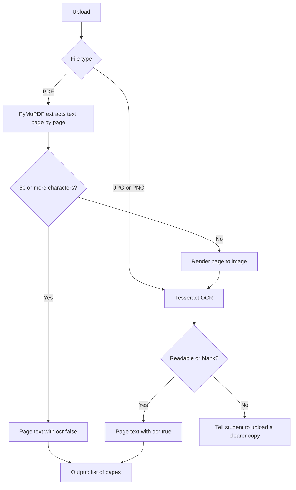

## Problem and Users
Problem: Students struggle to find a flexibe and realistic exam prep time table, prepare in a hard way rather than a smart way. To solve this comes Exam-Copilot an application that works as a website in its first version which takes input of PYQS and syllabus from student and analyze it. According to the analysis and time the student has AI generates time table with checklist, if by other reasons student get done with the checklist of the day or lagging behing the time table is modified accordingly so that the student can make the most of the limited time they have.
Users: VNRVJIET 2nd year CSE students.

## Scope
**In v1**
> Upload PYQ question paper and syllabus.
> AI analyzes it and gives weightage.
> AI gives output of the ranked list of units and topics [again in weightage ascending order] in ascending order according to the weightage.
**Not in V1**
> Generate a flexible time-table that changes according to the time and progress of the student in prep.
> Generate flashcards and store them to tell students which topics they are weak at and change the tt accordingly.
> Android application.
> RAG concepts.

## Architecture

### Stage 1: Text extraction

Uploads are handled by file type.

- **Images (JPG/PNG):** sent directly to Tesseract OCR, since PyMuPDF can only read PDFs.
- **PDFs:** PyMuPDF extracts text page by page, because one PDF can mix typed and scanned pages. Any page with fewer than 50 characters is treated as scanned: it is rendered to an image and sent to Tesseract. That page alone is sent, not the whole file.

**Unreadable pages:** after OCR, each page is checked for quality. A page is rejected if Tesseract's average word confidence is below 60 or fewer than half the words are real words. The student is told which page could not be read and asked to upload a clearer copy. Unreadable text is never passed to the next stage. A page that is genuinely blank is allowed to pass and is not reported as unreadable.

**Thresholds:** 50 characters and confidence 60 are initial values, to be tuned on real PYQs.

**Output:** a list of pages, each with its text and a flag showing whether OCR was used (`ocr: true/false`).

